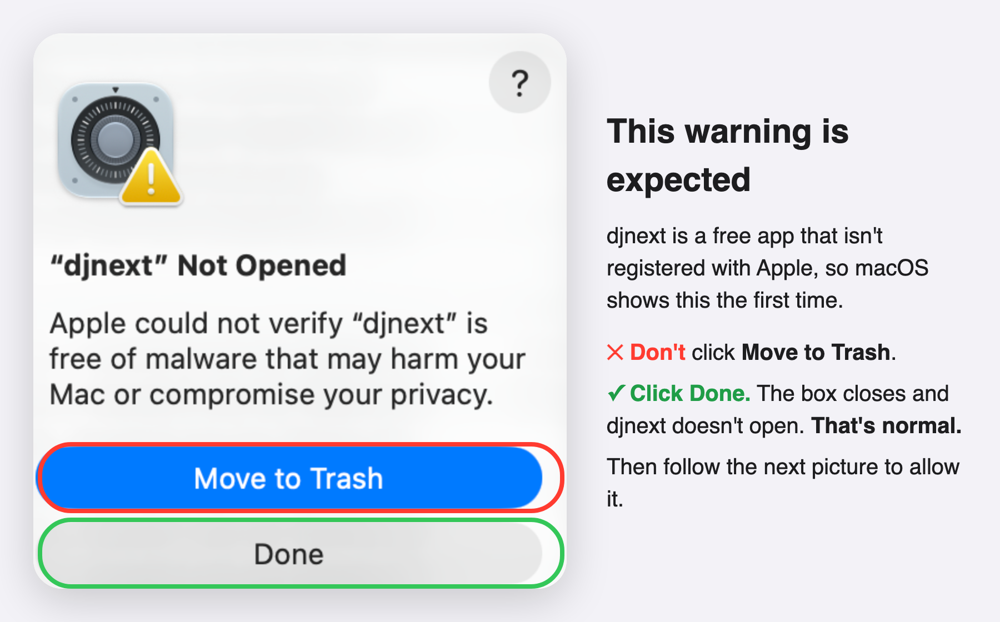
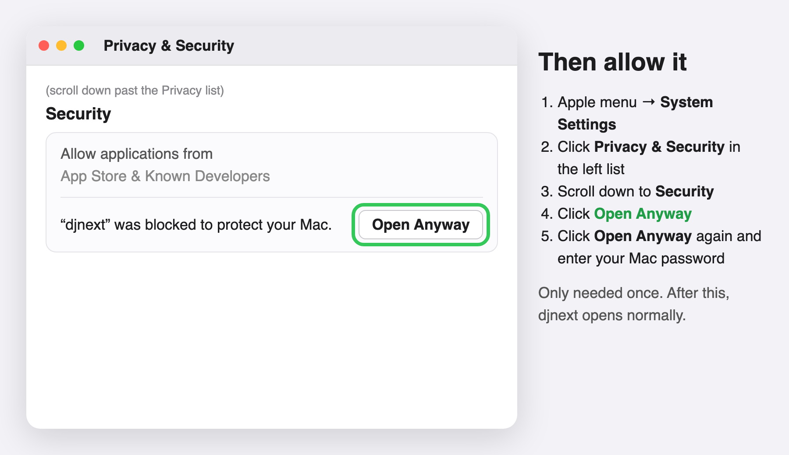

# 🎧 djnext

**The next track, from your own SoundCloud likes, so the dance floor never stops.** djnext sorts your likes into genre lists (groovy techno, tech house, house, indie dance & melodic, hard & fast…), picks a playlist from the one you choose where every track mixes cleanly into the next, and puts it in rekordbox with your hot cues already set.

- 🎯 **Only your likes:** it never suggests a track you haven't liked on SoundCloud.
- 🗂️ **Genre lists:** your likes sorted by the genres of the DJ sets they're played in, their tags and tempo. Move any track yourself, and send the lists to rekordbox as playlists.
- 🔗 **Tested pairs first:** tracks real DJs have played back to back (from public DJ tracklists) and pairs you've mixed before (your rekordbox history) come first.
- 🎚️ **Smooth flow:** tempo within 5%, compatible keys, long intros to blend over, never the same artist twice in a row.
- 💿 **Straight into rekordbox:** one button adds the playlist with hot cues on your pads: where to cue in, where to swap the bass, when to start the next track.

Free, and it runs only on your own computer. Made for the Pioneer DDJ-FLX4; it works with any controller you use with rekordbox.

---

## ✅ What you need first

1. **rekordbox 6 or 7** on your computer ([free download](https://rekordbox.com/en/download/)). Open it at least once.
2. **Your music inside rekordbox.** djnext can only suggest tracks that are in rekordbox's **Collection** and that rekordbox has **analysed** (that's where the tempo and key come from). Two kinds work:
   - **Downloaded files** (MP3, WAV, AIFF, FLAC…): drag them onto **Collection** in rekordbox's left sidebar. rekordbox analyses them by itself.
   - **Streamed tracks** from a service built into rekordbox, such as **SoundCloud** (needs a paid SoundCloud Go+ or DJ plan to play them in rekordbox), Apple Music, Beatport or TIDAL: add them to your **Collection** too ([how](#how-to-add-streamed-tracks-to-your-rekordbox-collection)).
   - ❌ **Spotify and YouTube don't work:** rekordbox can't play them, so djnext can't use them.
3. **A few dozen liked tracks in your style**, at least. More tracks = better playlists.
4. **A SoundCloud account with public likes.** djnext picks only from your SoundCloud likes that are also in your rekordbox Collection, one genre list at a time.
5. **Your DJ controller doesn't need to be plugged in** to install or use djnext. djnext never connects to it; it only reads and updates your rekordbox library. Plug it in when you play, as usual.

#### How to add streamed tracks to your rekordbox Collection
In rekordbox, click the streaming service in the left sidebar (for example **SoundCloud → Likes**), select the tracks (⌘A selects all), and **drag them onto Collection** at the top of the sidebar. Or load each track onto a deck once. rekordbox then analyses them, and djnext can use them.

---

## ⬇️ Download

### 🍎 Mac with an Apple chip (M1, M2, M3, M4…)
### 👉 [**Download djnext for Mac**](https://github.com/ayshsudhir/djnext/releases/latest/download/djnext.dmg)

Not sure which chip you have? Click the  Apple menu (top-left of your screen) → **About This Mac**. If it says **Chip: Apple M…**, this is the one for you. If it says **Processor: Intel**, use the Windows / Intel link below.

### 🪟 Windows, or a Mac with an Intel processor
### 👉 [**Download djnext (ZIP)**](https://github.com/ayshsudhir/djnext/archive/refs/heads/main.zip)
Then follow [the Windows / Intel steps](#install-on-windows-or-an-intel-mac) below.

---

## 🛠️ Install on a Mac in 4 steps

1. **Download** with the link above. It goes to your **Downloads** folder (click the ⬇️ arrow at the top-right of Safari or Chrome to see it).
2. **Double-click `djnext.dmg`.** A window opens with the djnext icon and an Applications folder. **Drag djnext onto the Applications folder.**
3. **Open djnext:** press **⌘ Space**, type **djnext**, press Enter.
4. **The first time only**, your Mac blocks djnext, because it's a free app that isn't registered with Apple (registering costs money). This is expected:

   

   - Click **Done**. The box closes and djnext doesn't open. That's normal.
   - Open the  Apple menu → **System Settings** → **Privacy & Security**, and scroll down to **Security**.
   - Next to *"djnext" was blocked to protect your Mac*, click **Open Anyway**. Click **Open Anyway** again and enter your Mac password.

   

   - Don't see **Open Anyway**? It only shows for about an hour after the warning. Open djnext again (step 3), click **Done**, and go straight back to System Settings.
   - **Shortcut instead of all the clicks:** open **Terminal** (⌘ Space, type *Terminal*, press Enter), paste this line and press Enter. It removes the "downloaded from the internet" mark from djnext only, and opens it:
     ```
     xattr -dr com.apple.quarantine /Applications/djnext.app && open /Applications/djnext.app
     ```
   - The installer window also has a help page, **If djnext won't open**, with a button that jumps straight to the right Settings page.

That's it. djnext opens with a [1-minute setup](https://github.com/ayshsudhir/djnext/blob/main/FRIENDS.md#first-time-setup): your SoundCloud link (optional), the kind of music you play, and whether you're a beginner or advanced DJ.

## Install on Windows or an Intel Mac

These need **Python 3** too: on Windows, install it from [python.org/downloads](https://www.python.org/downloads/) and **tick "Add python.exe to PATH"** in the installer.

1. **Download** the ZIP with the link above and double-click it in your Downloads folder to unzip it. Move the unzipped folder somewhere handy, for example Documents.
2. Open the folder and double-click **`Start djnext.bat`** (Windows) or **`Start djnext.command`** (Intel Mac).
   - Windows shows a blue "protected your PC" box? Click **More info → Run anyway**.
   - The Mac says it can't be opened? Right-click it → **Open → Open**.
3. The first start installs everything (a few minutes), then your browser opens djnext. **Keep the black window open** while you use it.

---

## 📖 How to use it

The full guide, in plain words: **[How to use djnext](https://github.com/ayshsudhir/djnext/blob/main/FRIENDS.md)**

Quick links:
- [The first time](https://github.com/ayshsudhir/djnext/blob/main/FRIENDS.md#first-time)
- [Genre lists](https://github.com/ayshsudhir/djnext/blob/main/FRIENDS.md#genre-lists)
- [Making a playlist](https://github.com/ayshsudhir/djnext/blob/main/FRIENDS.md#make-a-playlist)
- [How it picks](https://github.com/ayshsudhir/djnext/blob/main/FRIENDS.md#how-it-picks)
- [Something went wrong?](https://github.com/ayshsudhir/djnext/blob/main/FRIENDS.md#if-something-goes-wrong)
- [Getting a newer version](https://github.com/ayshsudhir/djnext/blob/main/FRIENDS.md#updating-and-removing)
- [Disclaimer (please read)](https://github.com/ayshsudhir/djnext/blob/main/FRIENDS.md#disclaimer)

Stuck? [**Ask a question here**](https://github.com/ayshsudhir/djnext/issues/new) (you need a free GitHub account), or message whoever sent you this link.

---

## 👩‍💻 For developers

Everything below is for people who want to run djnext from the code or change it. You don't need any of it to use the app.

### Run from the code
```bash
python3 -m venv .venv
.venv/bin/pip install -e '.[dev]'    # add ,mac for the own-window version
source .venv/bin/activate
djnext app                 # the app in your browser
python -m djnext.desktop   # the app in its own window (needs the mac extra)
djnext djsets              # look your likes up in DJ tracklists (MixesDB), once per track
djnext genres              # your likes, sorted into genre lists
djnext playlist -g tech-house -n 12   # print a playlist from one list (writes nothing)
pytest
```

### How it works
- **Library:** rekordbox's own database, read from a temporary **copy** (the real one is only written when you press Send, with rekordbox closed and a backup first). That gives tempo, key, phrase analysis and your play history.
- **Your likes:** read from your public SoundCloud likes page with yt-dlp (track list only) and matched to rekordbox's streamed SoundCloud tracks by id (`src/djnext/ingest/soundcloud.py`).
- **The pool:** likes that are analysed and are real tracks (2–15 min), one upload per song (`core/picker.py: pool`).
- **Genre lists:** `core/genres.py` adds up three clues: the MixesDB categories of the DJ sets a track was found in (Tech House, Techno, Deep House…, fetched 50 sets per request), the genre tag, and the tempo. Low-confidence tracks then follow their artist's or label's confident tracks. Your manual moves are saved in `data/settings.json` and always win.
- **DJ pairs:** each track is searched on [MixesDB](https://www.mixesdb.com)'s public API, and the tracklists that contain it are cached in `data/mixesdb.json` (`ingest/mixesdb.py`). A line only counts as the same track when the title **and** an artist or remixer match (`core/names.py`). That way "Cloonee - XTC" isn't confused with "Dan Molinari - XTC".
- **One move (A → B):** `core/picker.py: move` scores tempo, key, DJ back-to-back pairs, your own history, same-set and same-scene links, and intro length, and keeps a short list of reasons for the screen. `mixable` is the hard gate: within 5% tempo and at most one Camelot step.
- **The playlist:** a beam search over moves (`build`) plus flow rules: an energy shape, tempo that climbs rather than saw-tooths, no shared artist or remixer back to back, and a balance of well-known and deeper tracks.
- **Hot cues:** `core/mix_points.py` lines up B's drop with a phrase change in A, using rekordbox's phrase analysis. `export/rekordbox_cues.py` writes them as hot cues E, F and G (never over your own cues).

### Settings
[config.yaml](config.yaml) only holds the mix-point settings: play time per track, overlap, tempo range and beginner/advanced blends.

### Building the Mac app
`packaging/mac/build_app.sh` builds **djnext.app** (its own window, Python included) and a drag-to-Applications **.dmg** in `dist/`. It needs Python 3.10+ (`brew install python@3.12`). The app keeps its data in `~/Library/Application Support/djnext` and its log in `~/Library/Logs/djnext.log`. It's signed ad hoc (free), so friends click **Open Anyway** once in System Settings → Privacy & Security. Publish it with `gh release create v0.3.0 dist/djnext.dmg`. Keep the file name `djnext.dmg`: the download link at the top of this page always fetches the newest release's `djnext.dmg`.

### Disclaimer and licence
See the [disclaimer](https://github.com/ayshsudhir/djnext/blob/main/FRIENDS.md#disclaimer). MIT licence: see [LICENSE](LICENSE).
